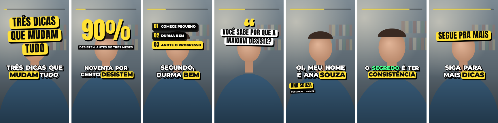
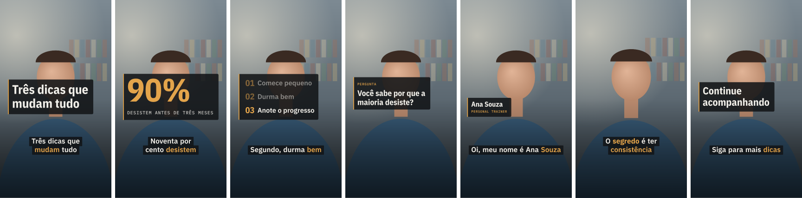

# Motion4Free

**Seus vídeos, do seu jeito. Edição direto no navegador.**

O Motion4Free é um editor de vídeo gratuito e de código aberto para criar Reels, Shorts, TikToks e outros vídeos para redes sociais. Você corta as gravações, adiciona legendas sincronizadas, escolhe o visual e exporta um MP4 sem instalar um editor nem criar uma conta.

**Sem cadastro. Sem marca-d'água. Sem assinatura obrigatória.**

[**Abrir o Motion4Free**](https://motion4free.murdokmurilo1.workers.dev/) · [English](README.md) · [Ver os estilos](https://motion4free.murdokmurilo1.workers.dev/?galeria) · [Reportar problema](https://github.com/murilaiooo/motion4free/issues)

> **Versão atual:** o Motion4Free continua em desenvolvimento. O aplicativo já pode ser usado, mas ainda estamos avaliando a qualidade com vídeos reais, a compatibilidade entre navegadores e alguns critérios de publicação. [Veja os testes mais recentes](docs/reviews/2026-10-30-v031-testes.md).

## O que dá para fazer?

### Editar seus próprios vídeos

Junte gravações, corte as partes que ficaram longas, corrija as legendas e ajuste o ritmo. Você pode começar por um estilo visual ou descrever a edição que quer fazer. O resultado continua nas suas mãos.

- Importe até 30 vídeos curtos, com até 3 minutos cada.
- Corte, divida, reorganize e duplique trechos em uma linha do tempo.
- Mova legendas e elementos diretamente na prévia.
- Exporte em MP4 vertical, retrato, quadrado ou horizontal.

### Transformar vídeos longos em clipes curtos

Gravou um podcast, uma entrevista, uma aula ou uma live? O Criador de Clipes aceita arquivos locais de 2 minutos a 2 horas. Ele transcreve a gravação e sugere trechos para você avaliar. Dá para conferir o que vem antes e depois, ajustar o início e o fim, escolher os melhores e baixar cada clipe ou continuar a edição.

As sugestões usam regras locais por padrão. Você também pode ativar uma análise de IA, mas ela depende do modelo e pode não funcionar ou recorrer às sugestões locais. **Revise o sentido de cada corte antes de postar.** Nenhum programa consegue garantir que um trecho vai viralizar ou que uma frase isolada mantém todo o contexto.

## Um visual para cada vídeo

O Motion4Free tem estilos editáveis, tipografia animada, destaques sincronizados com as palavras e composições pensadas para vídeos com fala. Comece por um modelo e ajuste o texto, o tempo, a posição e o enquadramento.

Alguns exemplos da galeria do próprio aplicativo:

**Pop**


**Editorial**


**Documental**


[Veja os outros estilos na galeria](https://motion4free.murdokmurilo1.workers.dev/?galeria).

## O que tem no editor

| Recurso | Para que serve |
| --- | --- |
| **Legenda automática** | Transcreve a fala com Whisper no próprio computador. Você corrige as palavras e mantém a legenda sincronizada. O download do modelo e a velocidade dependem do aparelho. |
| **Linha do tempo** | Permite cortar, dividir, reorganizar e revisar os vídeos com onda de áudio, desfazer e refazer. |
| **Textos e animações** | Oferece modelos visuais, títulos, destaques por palavra e elementos posicionados na tela. |
| **Formatos de vídeo** | Exporta em 9:16 (Reels/Shorts/TikTok), 4:5, 1:1 e 16:9. |
| **Ajuda criativa** | Você começa com opções guiadas, um pedido escrito, regras locais ou IA opcional, e pode revisar o resultado. |
| **Projetos e backups** | Guarda projetos neste navegador e permite baixar um backup `.m4f` com o projeto e as mídias copiadas. |
| **Exportação local** | Gera o MP4 no seu aparelho, sem marca-d'água do Motion4Free. Os codecs disponíveis dependem do navegador e do computador. |

## Como começar

1. [Abra o Motion4Free](https://motion4free.murdokmurilo1.workers.dev/) no **Brave, Chrome ou Edge, em um computador**.
2. Escolha **Editar meus vídeos** ou **Clipes de vídeo longo**.
3. Selecione arquivos seus ou que você tem autorização para editar. O app aceita formatos comuns, como MP4, MOV e WebM, desde que o navegador consiga decodificar o vídeo.
4. Escolha um estilo, confira os cortes e as legendas e ajuste o que precisar.
5. Baixe o MP4. Se quiser guardar o trabalho, salve também o backup `.m4f`.

A interface do aplicativo está em **português do Brasil**. Não é possível importar diretamente um link do YouTube; use o arquivo de um vídeo que você tem direito de editar.

## Gratuito e com controle sobre seus dados

Por padrão, o Motion4Free processa os vídeos no próprio computador. Não há conta nem servidor do Motion4Free para receber seus projetos. Os trabalhos salvos ficam no armazenamento local do navegador (OPFS).

A IA é opcional:

- **No computador:** a transcrição e os recursos locais rodam no seu aparelho. Alguns modelos precisam ser baixados e os mais pesados podem exigir uma GPU melhor.
- **Por API:** se você conectar sua própria chave, o navegador poderá enviar texto da transcrição ou áudio da fala diretamente ao provedor escolhido, **somente com a autorização específica para cada tipo de envio**. Autorizar texto não autoriza áudio. Valem os limites e possíveis cobranças do provedor.
- **Sem chave:** você continua podendo editar, aplicar estilos, usar as regras locais e exportar. Assinaturas como ChatGPT e Claude não incluem automaticamente créditos de API.

**Guarde seus backups.** O navegador pode apagar dados locais quando falta espaço ou quando um perfil é excluído. O arquivo `.m4f` contém mídia e transcrição e **não é criptografado**. Guarde-o em um local privado.

## Rodar no seu computador

Para quem quer desenvolver ou contribuir: Node.js 22 ou versão compatível e npm. O FFmpeg é necessário para criar vídeos sintéticos de teste, mas não para usar a versão online.

```bash
git clone https://github.com/murilaiooo/motion4free.git
cd motion4free
npm ci
npm run dev
```

Abra `http://localhost:5173`.

```bash
npm run typecheck
npm test
npm run build
npm run fixture   # requer FFmpeg
npm run e2e       # Playwright; pode exigir configuração do navegador
```

O projeto usa TypeScript, React, Vite, Mediabunny e Transformers.js. [Como contribuir](CONTRIBUTING.md) · [Documentação técnica](docs/INDEX.md) · [Estado da publicação](docs/release/STATUS.md) · [Histórico de versões](docs/CHANGELOG.md)

## Código aberto e em evolução

Encontrou um erro, uma tela confusa ou um problema com legenda, formato ou exportação? Conte nos [Issues do GitHub](https://github.com/murilaiooo/motion4free/issues). Não publique vídeos privados, transcrições ou chaves de API. Para problemas sensíveis, consulte [Segurança](SECURITY.md).

O código do Motion4Free usa a [licença MIT](LICENSE). Bibliotecas, fontes, modelos e recursos de terceiros seguem suas próprias licenças e avisos; veja [Licenças de terceiros](docs/licencas.md). Use apenas vídeos e áudios que você tem permissão para editar e publicar.
